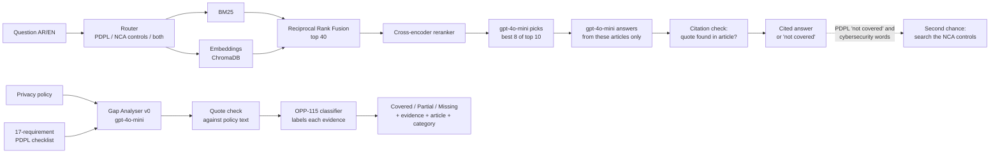

# PDPL Copilot

**AIEP Capstone, Track B: Saudi Personal Data Protection Law (PDPL) compliance assistant**

> ⚠️ **Not legal advice.** PDPL Copilot is a student project. Its answers and gap reports can be wrong and must be checked against the official texts and a qualified lawyer.

PDPL Copilot does three things:

1. **Bilingual legal Q&A.** Ask a question about the PDPL in Arabic or English. The system finds the relevant articles of the PDPL, its Implementing Regulation and the Transfer Regulation, and answers **only** from them, citing the article for every sentence. If the texts do not answer the question, it says **"not covered"** instead of guessing.
2. **Cybersecurity controls Q&A.** The same assistant also answers from the National Cybersecurity Authority's Essential Cybersecurity Controls (ECC-2:2024). A router decides for each question whether it needs the PDPL, the controls, or both. An Arabic question gets an Arabic answer quoting the official Arabic text; an English question gets English.
3. **Privacy policy Gap Analyser.** Give it a company's privacy policy (link, file or pasted text). For each of 17 PDPL requirements it reports **covered / partial / missing**, with the sentence from the policy as evidence and the PDPL article behind the requirement.

## Team

| Member | Role |
|---|---|
| Rana | Legal corpus (PDPL, IR, TR in Arabic and English), gold Q&A set |
| Mathayel | RAG: retrieval, reranking, answering, citation checking (experiments E1, E2, E3, E5) |
| Danah | OPP-115 clause classifier: TF-IDF baseline vs fine-tuned BERT (experiment E4) |
| Ahlam | Gap Analyser, Saudi policies and labels, Streamlit app, NCA cybersecurity controls |

## Why

Since the PDPL came into force, every company that handles personal data in Saudi Arabia must publish a privacy policy that tells people what the law requires. Reading the law and checking a policy against it by hand is slow, and general chatbots answer legal questions confidently without citing the text. PDPL Copilot answers from the law itself, shows its sources, and refuses when the law does not cover the question.

## How it works



- **Retrieval** (`retrieval/retriever.py`): BM25 with Arabic tokenisation + multilingual MiniLM embeddings stored in ChromaDB, fused with RRF, then the small cross-encoder `cross-encoder/mmarco-mMiniLMv2-L12-H384-v1`, then gpt-4o-mini picks the 8 best of the top 10 (falls back to the reranker order without network).
- **Answering** (`retrieval/answer.py`): the LLM writes each sentence with the article ids it relies on and a short quote. `retrieval/citation_check.py` drops citations that do not exist, were not retrieved, or do not support the sentence. Every live answer is cached in `results/answers_cache.json`, which is the offline fallback for the demo.
- **Gap Analyser** (`src/gap/analyse_v0.py`): checks a policy against `data/checklist/pdpl_checklist.csv` (17 requirements from PDPL Art. 12, 13 and IR Art. 4). Every quote the model returns is searched for in the policy text; a quote that is not there is flagged.
- **Classifier** (`src/classifier/classify.py`): labels English policy paragraphs with the 10 OPP-115 categories. `src/gap/evidence_labels.py` connects it to the Gap Analyser: each evidence sentence (translated to English with gpt-4o-mini if it is Arabic) is labelled by the classifier, the label is shown next to the evidence in the app, and it is checked against the OPP-115 categories the checklist links to that requirement. The classifier does not change the analyser's verdicts.
- **Second corpus: NCA Essential Cybersecurity Controls (ECC-2:2024)**: `src/nca/build_ecc.py` reads the official English and Arabic PDFs into 108 controls in each language (`data/processed/ecc_controls_v2024.{json,csv}`; domain, subdomain, objective, control text). The Arabic PDF has ligatures with no text value; `src/nca/arabic_pdf.py` maps them back and checks every control number against the English one. `retrieval/router.py` (gpt-4o-mini, keyword fallback) sends each question to the PDPL, to the controls, or to both; `retrieval/ecc_retriever.py` runs the same search pipeline on its own index, in the question's language. Questions routed to the PDPL are answered exactly as before.
- **Second chance** (`retrieval/answer.py`): when the router sent a question to the PDPL, the PDPL texts do not answer it and it uses cybersecurity words, the controls are searched too. A question the PDPL answers never gets there.
- **Finding a policy** (`src/policies/`): the app takes a company name, a website, a policy link, or a file (PDF, Word, TXT, `read_file.py`). It looks in this order: the 11 Saudi policies and the global companies analysed ahead (`data/library/`, `src/gap/analyse_library.py`); the company's own site (`find_policy.py`: privacy link, sitemap, common paths; robots.txt is respected); public archives (`archive.py`: Open Terms Archive, Wayback Machine, Common Crawl); and last, an OpenAI web search (`web_search.py`), whose copy may be incomplete, so the requirements it lacks are shown grey and the result is marked incomplete. Sites that block bots are never worked around; the user can upload the policy instead.
- **In the app** the quotes are marked inside the policy text (green covered, amber partial; missing requirements are listed above the text, `src/gap/highlight.py`), and the gap report can be downloaded as a PDF with an evidence appendix (`src/gap/report_pdf.py`, Arabic or English; font IBM Plex Sans Arabic, OFL, in `app/fonts/`).

## Data

| Data | Where | Source and licence |
|---|---|---|
| Legal corpus: PDPL 43 + IR 38 + TR 9 articles, AR + EN, one record per article (document, chapter, article number, language, text) | `data/processed/legal_articles_v1.0.{json,csv}` | Official texts published by SDAIA; scraped with `src/data/build_legal_corpus.py`; manual review in `data/review/` |
| Gold Q&A: 40 development questions (6 unanswerable) + 20 test questions (6 unanswerable) | `data/evaluation/` | Written and reviewed by the team; see the READMEs in that folder |
| OPP-115 privacy policy segments | `data/opp115/`, `data/opp115_segments.{csv,parquet}`, split in `configs/split.json` | OPP-115 corpus (Wilson et al., 2016), for research use |
| NCA Essential Cybersecurity Controls ECC-2:2024: 108 controls, AR + EN | `data/processed/ecc_controls_v2024.{json,csv}`, questions in `data/evaluation/ecc_gold.csv` | Published by the National Cybersecurity Authority (https://nca.gov.sa/en/regulatory-documents/controls-list/ecc/); download the English and Arabic PDFs into `data/nca/` and run `python -m src.nca.build_ecc` |
| 11 Saudi privacy policies + team labels (187 policy × requirement labels) | `data/policies/`, `data/labels/team_labels.csv` | Each policy belongs to its company; texts kept for non-commercial education with source link and download date (`data/policies/README.md`). Re-download with `python -m src.policies.fetch_policies` |
| PDPL requirements checklist | `data/checklist/` | Written by the team from the articles |
| Global company list for the policy page | `data/library/companies.csv`, `library.csv` | Company names and policy links; the policy texts are kept local (`data/library/texts/`, not in the repository) |

## Setup

Python 3.10+ recommended.

```bash
git clone https://github.com/dralsarrani/PDPLComplianceCopilot.git
cd PDPLComplianceCopilot
python -m venv .venv
# Windows: .venv\Scripts\activate    macOS/Linux: source .venv/bin/activate
pip install -r requirements.txt
```

Copy `.env.example` to `.env` and add your own OpenAI key:

```
OPENAI_API_KEY=your-key-here
OPENAI_MODEL=gpt-4o-mini
```

The first run downloads the embedding and reranker models and builds `chroma_db/` (a few minutes).

## Run the demo app

```bash
python -m streamlit run app/app.py
```

What the app shows:

- **Ask the law**: the answer sentence by sentence, each with its article or control number and the exact quote found in the text; source cards; a line linking the official texts (SDAIA for the PDPL, NCA for the controls); which texts were searched for cybersecurity questions; the full text of the cited articles; how many citations were checked.
- **Check a privacy policy**: a score out of 17 with a verdict (good / average / weak), the most important missing requirements in plain words with why each matters, all 17 requirements with their evidence quote, the PDPL article and the OPP-115 category the classifier gives the evidence, the policy text with the evidence highlighted, and a PDF download of the report.
- A history panel of past questions and analyses (`results/history.json`, local only), an Arabic / English interface and a dark mode.

Without network, questions that were answered before are served from the cache (`results/answers_cache.json`): ask the demo questions once before presenting.

From the command line:

```bash
python -m retrieval.answer "هل يجوز نقل بيانات العملاء خارج المملكة؟"
python -m src.gap.analyse_v0 data/policies/tamara.txt
```

## Reproduce the results

All commands run from the project root.

| What | Command | Needs OpenAI key | Output |
|---|---|---|---|
| Quick check that the system works (a few seconds) | `python -m unittest discover tests -v` | No | 11 tests, `OK` |
| Retrieval per method and language | `python -m retrieval.evaluate_by_language` | Final row only | `results/retrieval_by_language.csv` |
| Full Q&A on the gold set | `python -m retrieval.evaluate_answers` | Yes | `results/answer_eval.json` |
| Same two on the 20 test questions | add `--test` to the two commands above | As above | `results/retrieval_by_language_test.csv`, `results/answer_eval_test.json` |
| Citation checker on hand-made cases | `python -m retrieval.evaluate_citation_check` | Yes | `results/citation_check_eval.json` |
| Reranker comparison | `python -m retrieval.compare_rerankers --fast` | No | printed |
| Gap Analyser vs team labels | `python -m src.gap.evaluate_gap` (add `--v1` for v1) | No | `results/gap_eval/`, `results/gap_eval_v1/` |
| Classifier labels on the analyser's evidence | `python -m src.gap.evidence_labels` | Yes | `results/gap_opp115/` |
| E1: LLM only vs full system | `python -m retrieval.experiment_e1_llm_only` | Yes | `results/e1_llm_only.json`, `.csv` |
| Experiments E1, E2, E3, E5 (retrieval) | `python -m retrieval.experiment_e1` (and `_e2`, `_e3`, `_e5`) | No | printed; summary in `EXPERIMENT_RESULTS.md` |
| Cybersecurity controls: routing and search | `python -m retrieval.evaluate_ecc` | Yes | `results/ecc_eval/` |
| Classifier (E4) | `notebooks/02_split.ipynb` to `06_error_analysis.ipynb` | No | `results/e4_*.csv` |

The classifier split is by policy (70/15/15) with seed 42 (`configs/split.json`). The fine-tuned model is on Hugging Face (`dralsarrani/opp115-bert`, set by `CLASSIFIER_MODEL` in `.env`); the TF-IDF baseline is saved in `artifacts/classifier/baseline.joblib`.

## Results

### Retrieval (34 answerable development questions, 17 AR + 17 EN)

| Method | Recall@5 all | Recall@5 AR | Recall@5 EN | MRR all |
|---|---|---|---|---|
| BM25 | 62.7 | 55.9 | 69.6 | 0.678 |
| Embeddings | 52.5 | 32.4 | 72.5 | 0.543 |
| Hybrid (RRF) | 56.9 | 41.2 | 72.5 | 0.635 |
| Hybrid + reranker | 83.3 | 82.4 | 84.3 | 0.881 |
| **Final (app): + LLM pick** | **90.2** | **88.2** | **92.2** | **0.929** |

The multilingual MiniLM embeddings are weak in Arabic (32.4); the reranker closes most of that gap.

### Held-out test set (20 questions never used for tuning: 14 answerable, 7 AR + 7 EN, and 6 unanswerable)

| Metric | Result |
|---|---|
| Retrieval Recall@5 / MRR, Final (app) | 100% / 1.0 (BM25 85.7% / 0.811, hybrid + reranker 96.4% / 0.929) |
| Answerable questions citing a correct gold article | 92.9% (13/14) |
| Answer sentences whose quote was found word for word | 96.7% |
| Unanswerable questions answered "not covered" | 83.3% (5/6) |
| Answerable questions wrongly answered "not covered" | 0% (0/14) |
| Average seconds per question | 11.1 |

Two errors: Q012 cited IR-A22 instead of PDPL-A14, and Q053 (unanswerable) was answered with PDPL-A42. With only 20 questions, one error moves a score by 5 to 17 points.

### Answers (40 development questions)

| Metric | Result |
|---|---|
| Answerable questions citing a correct gold article | 97.1% (33/34) |
| Answer sentences whose quote was found word for word in the cited article | 93.8% |
| Unanswerable questions answered "not covered" | 100% (6/6) |
| Answerable questions wrongly answered "not covered" (false refusal) | 0% (0/34) |
| Citation checker on 14 hand-made cases (correct, invented, unrelated, missing, not retrieved) | 14/14 |

### Human grading of the answers (40 development questions, 0 = wrong, 1 = partly right, 2 = right)

Two team members (Ahlam and Danah) graded every answer against the reference answer, independently and without seeing each other's scores.

| | Result |
|---|---|
| Mean score, grader A / grader B | 1.80 / 1.30 |
| Same score | 35% |
| Within one point | 95% |
| Cohen's κ | 0.05 |

Only two answers got opposite scores (Q006 and Q027); most disagreements were 2 against 1, on whether an answer shorter than the reference answer is "complete". We report the scores as given, without adjudication.

### Experiments (details in [`EXPERIMENT_RESULTS.md`](EXPERIMENT_RESULTS.md))

| # | Question | Result |
|---|---|---|
| E1 | Which retrieval method finds the right article? | Recall@5: BM25 62.7%, hybrid 56.9%, hybrid + reranker **83.3%** |
| E1 | Does retrieval help the answers? (LLM only vs full system, same gpt-4o-mini) | Right article cited: **14.7% vs 97.1%**. Quotes found in the cited article: **0% vs 93.8%**. Answered: 70.6% vs 100%. Both said "not covered" to 6/6 unanswerable questions |
| E2 | Article chunks or fixed 200-word chunks? (BM25) | Fixed chunks slightly better: AR 52.9% vs 47.1%, EN 68.6% vs 65.7% |
| E3 | English-only or multilingual embeddings? | Arabic Recall@5 2.9% → **32.4%** with the multilingual model; English 75.5% vs 72.5% |
| E4 | TF-IDF or fine-tuned BERT for OPP-115? | macro-F1 0.742 → **0.783** (table below) |
| E5 | Does a retrieval-score threshold catch out-of-scope questions? | Catches 6/6 but wrongly refuses 8/34. The app instead relies on the answer prompt's "not covered" rule: 6/6 caught, 0/34 wrongly refused |

### Gap Analyser (11 Saudi policies × 17 requirements = 187 team labels)

| Version | Accuracy (3 classes) | Mentioned vs missing | Cohen's κ | F1 covered / partial / missing |
|---|---|---|---|---|
| **v0 (used in the app)** | **77.5%** | **93.0%** | **0.452** | 0.87 / 0.32 / 0.70 |
| v1 (yes/no sub-questions) | 72.7% | 87.2% | 0.445 | 0.84 / 0.47 / 0.52 |

v0 is too lenient: in 22 of 32 cases the team labelled *partial*, v0 said *covered*. v1 handles *partial* better but is too strict overall. Details per requirement and per policy are in `results/gap_eval*/`.

### Clause classifier, OPP-115 (test set, macro-F1 over 10 categories)

| Model | Macro-F1 |
|---|---|
| TF-IDF + logistic regression | 0.742 |
| **Fine-tuned BERT** | **0.783** |

Per-category F1 is in `results/e4_test_comparison.csv`.

### Classifier on the Gap Analyser's evidence (170 evidence sentences from the 11 Saudi policies)

Does the classifier's top OPP-115 label for an evidence sentence fall in the categories the checklist links to that requirement?

| Evidence | Match |
|---|---|
| All | **75.9%** (129/170) |
| Arabic, translated to English | 78.1% (25/32) |
| English | 75.4% (104/138) |

The link holds for collection, sharing, retention and security (R03 to R05, R07, R09: 100%) but not for the data subject's rights: R13 (9%) and R14 (36%) are mostly labelled *Other*. OPP-115 categories and PDPL requirements overlap but are not the same thing.

### Cybersecurity controls (NCA ECC-2:2024): 12 team questions + the 60 PDPL gold questions

12 questions written by the team, each from one control (6 Arabic, 6 English; 2 also mention personal data and should go to both texts), in `data/evaluation/ecc_gold.csv`. Scored once, no tuning.

| What | Result |
|---|---|
| Router sends the cybersecurity question to the right text | 91.7% (11/12) |
| PDPL gold questions (40 development + 20 test) still sent to the PDPL only | **100%** (60/60) |
| Same, with the second chance in `answer()` (added after seeing the miss, so not a blind score) | 100% (12/12) |
| Right control in the top 5 | **100%** (12/12) |
| MRR | 0.903 |

The one routing miss (ECC02, whether non-Saudis may hold cybersecurity jobs) went to the PDPL. To catch such misses, `answer()` gives a second chance: when the PDPL texts do not answer a question that uses cybersecurity words, the controls are tried as well (a question the PDPL answers never gets there). The one unanswerable PDPL question with cybersecurity words (Q060) still gets "not covered". Because all 60 PDPL questions stay on the PDPL route with the unchanged PDPL prompt, the PDPL results above still hold. We tried a broader router prompt (all 29 ECC subdomain titles plus "any cybersecurity question goes to the controls"): it routed 12/12 cybersecurity questions right but moved 2 of the 60 PDPL questions away from the PDPL, so we kept the first router. Twelve questions are a small sample.

## Limitations

- The retrieval settings were tuned on the same 40 development questions they are scored on, so those numbers are optimistic. The 20 held-out test questions (`data/evaluation/gold_qa_test.json`) were scored once, after tuning; they are in this public repository, so they are not a fully blind holdout.
- E2 and E5 were run with BM25 or retrieval scores, not the full pipeline. In the LLM-only run, a citation counts as right if it names the gold article in either language, which favours that run.
- E2 found fixed-length chunks slightly better than article chunks under BM25. The app keeps article chunks because every citation must point to one whole article.
- Each Saudi policy was labelled by one team member only, so there is no inter-annotator agreement on the labels. The team rule was: a requirement the policy never mentions is *missing*.
- The Gap Analyser does not tell *covered* from *partial* well (partial F1 0.32).
- The classifier is English only; Arabic evidence is machine-translated before it is labelled. It labels the analyser's evidence but does not yet help choose the verdict.
- The *chapter* field is empty: the official texts (SDAIA platform and the Bureau of Experts page) list the articles without chapter headings, so there is no chapter to record. Retrieval and citations use the article number.
- The Arabic NCA controls are rebuilt from the PDF's glyphs (11 ligatures mapped by hand, 3 words the PDF splits joined again); a few spacing or vowel-mark slips may remain.
- The router adds one gpt-4o-mini call (about one second) to every question.
- The two graders agreed little on the 0 to 2 answer scores (κ 0.05): the scale did not say how complete a "2" must be.
- A policy found by OpenAI web search may be summarised rather than copied word for word; the app marks such results as incomplete.

## Repository structure

```
app/                 Streamlit app (app.py, CSS for light/dark and right-to-left/left-to-right, fonts for the PDF)
retrieval/           BM25, embeddings, hybrid, reranking, router, NCA controls search, answer(), citation check, evaluations
src/data/            legal corpus builder
src/classifier/      OPP-115 data, split, classify()
src/nca/             NCA cybersecurity controls corpus builder
src/gap/             Gap Analyser v0/v1, evaluation, label sheet, highlighting, PDF report, library analysis
src/policies/        finding, fetching and reading privacy policies (site, archives, web search, files)
data/                legal corpus, gold Q&A, checklist, policy list, labels, OPP-115 segments
notebooks/           corpus visualisation, classifier experiments (E4), error analysis
configs/split.json   classifier train/val/test split (seed 42)
artifacts/           saved TF-IDF baseline
results/             evaluation outputs used in the report
tests/               quick checks of data, citation checking and quote matching
```

## Licence

Code: Apache 2.0 (see `LICENSE`). Legal texts belong to SDAIA; the Essential Cybersecurity Controls belong to the National Cybersecurity Authority; privacy policies belong to their companies and are used for non-commercial education only.
